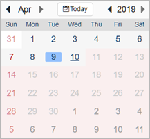

# カレンダーを使用して日付を指定

## （新しいUI）日付範囲の選択

1. データテーブルの右上で、カレンダーアイコンが表示されている日付範囲コントロールをクリックします。

1. **[!UICONTROL Period]** メニューから、日付範囲を指定します。

   * プリセット範囲を使用するには、最初のカレンダーの上にあるメニュー（**[!UICONTROL Yesterday]**&#x200B;や&#x200B;**[!UICONTROL Last 7 Days]**&#x200B;など）からオプションを選択します。

   * カスタム範囲を使用するには、**[!UICONTROL Custom Date Range]**&#x200B;を選択し、カレンダーの開始日と終了日を選択します。 カレンダーの矢印を使用して、月を移動します。

1. **[!UICONTROL Apply]**&#x200B;をクリックします。

2つの期間のデータを比較するには、「[日付範囲でデータをフィルタリング ](/help/search-social-commerce/common-tasks/data-views/ad-hoc-settings/date-filter.md#date-filter-new-ui)」を参照してください。

## 個別の日付を選択

個々の日付カレンダーフィールド（従来のユーザーインターフェイスのカレンダーフィールドを含む）には、次の手順を使用します。

1. 「」をクリックして、カレンダーを開きます。

   >[!NOTE]
   >
   >カレンダーボタンは、日付入力オプションが選択されている場合にのみ有効にできます。

   

1. 次のいずれかのオプションを使用して日付を選択します。

   * 日付をクリックします。

   * （最も多くのビュー） 1か月または1年ずつ前または後に進めるには、それぞれ&#x200B;**`<`**&#x200B;または&#x200B;**`>`**&#x200B;をクリックします。

   * （従来の[!UICONTROL Portfolios] ビュー）別の月または年を選択するには、月または年の名前をクリックし、月または年をクリックします。

   * 現在の日付を強調表示するには、**[!UICONTROL Today]**&#x200B;をクリックします。

1. **[!UICONTROL Apply]**&#x200B;をクリックします。
