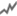

# （新しいUI） ポートフォリオパフォーマンスの詳細の表示

*Beta機能*

<!-- Verify all, including why (if) the first report is for active and optimized portfolios(?), and why the other reports are for active portfolios, not optimized ones -->

ポートフォリオの詳細ビューには、ポートフォリオに関する次の情報が含まれます。

* 最大3つのパフォーマンス指標の実際の値と予測値。 レポートには、ポートフォリオの合計指標値と、日付ごとの指標の内訳が含まれます。<!-- Not for active portfolios only?  -->

* アクティブなポートフォリオのモデル精度データ。モデルが予測からどの程度偏差しているかを示します。 このレポートには、毎日またはローリングの7日間のコスト精度、クリック精度、および目標値の精度が全体的に表示されます。

  データは、トレンドチャート（デフォルト）またはテーブルとして表示できます。

* アクティブなポートフォリオの実際の費用に対するターゲット支出。 オプションで、ポートフォリオのキャンペーン予算合計も含めることができます。

* 広告ネットワーク別のアクティブなポートフォリオのコスト、クリック、または[目標値](/help/search-social-commerce/glossary.md#o-p)予測の正確性。<!-- Verify -->

* ポートフォリオ設定。

  必要に応じて、ポートフォリオ設定を開いて編集できます。

* ポートフォリオ内の広告ネットワーク、アカウント、キャンペーン、広告グループ、キーワードのリストと、パフォーマンスデータ。

  個々のキーワードについて、予測、履歴情報、階層情報などの入札単位の詳細を表示できます。 [!UICONTROL Bid Unit Details] ビューには、選択した入札単位に関する次の予測、履歴情報、および階層情報が含まれます。

  * [!UICONTROL Forecast] タブ：異なる入札価格での入札単位の現在の予測クリック数、コスト、クリック単価、位置、収益。 すべてのデバイスと各デバイスタイプ （[!UICONTROL Mobile]、[!UICONTROL Computer]、および[!UICONTROL Tablet]）のデータが表示されます。<!-- Probably no longer applicable: For portfolios using v6 of the optimization capability, both the [!UICONTROL Computers] and [!UICONTROL Tablets] tabs show the combined totals for computers and tablets. For portfolios using v7, however, all data for the [!UICONTROL Computers] and [!UICONTROL Tablets] tabs is separate. -->

    **注：** デバイス固有のデータが不十分で、そのデバイス タイプのモデルの構築や調整の設定に利用できない場合、デバイス タイプの予測データは利用できません。 **注意：**&#x200B;特定の日付範囲でクリックを受けたポートフォリオ内の各入札単位のコスト精度または収益精度を確認するには、ポートフォリオのコスト精度の詳細または収益精度の詳細をそれぞれ表示します。

  * [!UICONTROL History] タブ：入札日ごとに表示された日付と時刻、インプレッション数、クリック数、総費用、平均CPC、平均順位、クリック日で表示された加重収益など、過去36日間のすべての入札。 データは、すべてのデバイスおよび各デバイスの種類（モバイル、コンピューター、タブレット）について表示されます。<!-- Probably no longer applicable: For portfolios using v6 of the optimization capability, both the [!UICONTROL Computers] and [!UICONTROL Tablets] tabs show the combined totals for computers and tablets. For portfolios using v7, however, all data for the [!UICONTROL Computers] and [!UICONTROL Tablets] tabs is separate. **Note:** Whenever the optimization method changes from v6 to v7 and vice-versa, the history data is reset the same day. -->

  * [!UICONTROL Details] タブ：キーワード、一致タイプ（該当する場合）、入札単位が属する親広告グループ、キャンペーン、およびネットワークアカウントとポートフォリオ。

## ポートフォリオのパフォーマンスの詳細を開く

1. メインメニューで、**[!UICONTROL Manage]>[!UICONTROL Portfolios]**&#x200B;をクリックします。

1. ポートフォリオ名の上にカーソルを置き、をクリックします。

1. （オプション）ポートフォリオの詳細の日付範囲を変更するには、右上の日付範囲をクリックし、日付範囲を指定してから「**[!UICONTROL Apply]**」をクリックします。

1. （オプション） **[!UICONTROL Data Aggregation]** メニューから、各行に含まれるデータの時間単位を変更します：*[!UICONTROL Daily]、*、*[!UICONTROL Weekly]、*&#x200B;または&#x200B;*[!UICONTROL Monthly]。*

   使用可能なオプションは、選択した日付範囲によって異なります。 現在の集計が新しい日付範囲で使用できない場合は、別の使用可能な集計が自動的に選択されます。

1. （オプション）ページヘッダーの&#x200B;**[!UICONTROL Conversion Based On]** メニューから、**[!UICONTROL Click Date]**&#x200B;または&#x200B;**[!UICONTROL Transaction Date]**&#x200B;を選択します。

   この設定は、ポートフォリオレポートとコンポーネントリストのコンバージョンデータに適用されます。

別のポートフォリオの詳細を表示するには、ポートフォリオ名の横にあるポートフォリオセレクターを使用します。

## [!UICONTROL Portfolio Overview] タブをカスタマイズ

* （オプション） [!UICONTROL Portfolio Performance] レポートをカスタマイズするには、次のいずれかの操作を行います。

  * 合計指標と詳細指標の両方に使用されるパフォーマンス指標を変更するには、**[!UICONTROL Metrics]**&#x200B;をクリックし、最大3つの指標を選択します。

    デフォルトの指標は&#x200B;*[!UICONTROL Cost]*、*[!UICONTROL Clicks]*、および&#x200B;*[!UICONTROL Objective Value]*.<!-- What else is available: the advertiser's revenue metrics? Anything else from the ad networks? -->です

  * 詳細な指標については、次を参照してください。

    * **[!UICONTROL Display predictions]**&#x200B;の横にあるスイッチを移動して、予測指標の値を表示または非表示にします。

    * グラフ ビュー（）とテーブル ビュー（）を切り替えます。

    * （グラフ表示）グラフ上の任意のポイントのデータを表示するには、そのポイントにカーソルを合わせます。

    * （グラフ表示で）ズームするには、グラフ上の領域を選択します。

    * （ポートフォリオ設定 – 変更マーカーが表示されている場合）マークされた日付のポートフォリオの変更履歴を表示するには、グラフのマーカーをクリックします。 履歴について詳しくは、「[&#x200B; ポートフォリオの変更履歴を表示](portfolio-view-change-history.md#portfolio-change-history)」を参照してください。

* （オプション） [!UICONTROL Model accuracy]傾向グラフをカスタマイズするには、次のいずれかの操作を行います。

  * グラフ ビュー（）とテーブル ビュー（）を切り替えます。

  * *[!UICONTROL Daily Accuracy]*&#x200B;と&#x200B;*[!UICONTROL 7 Day Rolling Accuracy]*&#x200B;に関するデータの表示を切り替えます。

    [!UICONTROL 7 Day Rolling Accuracy]は、過去7日間の予測の平均精度で、パーセントで表されます。 例えば、2025年5月8日の値は、2025年5月1日～5月7日の平均精度です。

    [!UICONTROL 7 Day Rolling Accuracy]は、[!UICONTROL Data Aggregation]が[!UICONTROL Daily]に設定されている場合にのみ使用できます。

  * （グラフ表示）グラフ上の任意のポイントのデータを表示するには、そのポイントにカーソルを合わせます。

* （オプション） [!UICONTROL Target vs actual spend]傾向グラフをカスタマイズするには、次のいずれかの操作を行います。

  * **[!UICONTROL Display budget]**&#x200B;の横にあるスイッチを移動して、各日付のキャンペーンの総予算を表示または非表示にします。

  * グラフ上の任意のポイントのデータを表示するには、そのポイントの上にカーソルを置きます。

* （オプション） [!UICONTROL Network Accuracy]傾向グラフをカスタマイズするには、次のいずれかの操作を行います。

  * 報告された指標を&#x200B;*[!UICONTROL Cost]*、*[!UICONTROL Clicks]*&#x200B;または&#x200B;*[!UICONTROL Objective Value]*&#x200B;に変更します。

  * 複数のネットワークでデータが使用可能な場合は、指標メニューの横にあるメニューからネットワークを選択します。

  * グラフ上の任意のポイントのデータを表示するには、そのポイントの上にカーソルを置きます。

  * ズームするには、グラフ上の領域を選択します。

## ポートフォリオコンポーネントのリストのカスタマイズ

[!UICONTROL Networks]、[!UICONTROL Accounts]、[!UICONTROL Campaigns]、[!UICONTROL Ad Groups]および[!UICONTROL Keywords]のタブには、次のコントロールが含まれます。

* 名前で検索するには、表の上の検索フィールドにテキストを入力して、検索を送信します。

* データを[&#x200B; フィルターするには、をクリックします。 &#x200B;](/help/search-social-commerce/common-tasks/data-views/ad-hoc-settings/column-filter-apply-from-toolbar.md)テーブルの上にあるフィルターコントロールを使用して、適用されたフィルターを編集または削除できます。

* ネットワーク、アカウント、キャンペーンまたは広告グループのコンポーネントを次のタブで表示するには、その名前をクリックします。 選択した親がテーブルの上のパンくずリストに表示され、該当するフィルターはドリルダウンすると続行されます。 タブを切り替えても、親の選択によってリストが引き続き制限される場合があります。

  ドリルダウン選択（ネットワーク名やアカウント名など）を削除するには、テーブルの上にあるパンくずリスト内のコンポーネント名の横にある&#x200B;**[!UICONTROL X]**&#x200B;をクリックします。 上位レベルの親の選択は引き続き有効です。 ポートフォリオ内のすべてのコンポーネントに戻るには、残りの親の選択とその他のフィルターを削除します。

* データを更新するには、をクリックします。

* （[!UICONTROL Accounts]、[!UICONTROL Campaigns]、[!UICONTROL Ad Groups]、および[!UICONTROL Keywords] タブのみ）表示される列または並べ替え順序を変更するには、をクリックし、[列セットと並べ替えオプション &#x200B;](/help/search-social-commerce/common-tasks/data-views/ad-hoc-settings/column-set-edit-sort-icon.md)を編集します。

## ポートフォリオ内の広告ネットワークのリスト

* 「**[!UICONTROL Networks]**」タブをクリックします。

## ポートフォリオのアカウントのリスト

* ポートフォリオ内のすべてのアカウントを表示するには、「**[!UICONTROL Accounts]**」タブをクリックします。

* ポートフォリオ内の特定のネットワークのアカウントを表示するには、「**[!UICONTROL Networks]**」タブをクリックし、ネットワーク名をクリックします。

## ポートフォリオ内のキャンペーンのリスト

各キャンペーンの詳細には、入札戦略、実際のコストと予測コスト、クリック数、目標値、コスト、クリック数、目標値の精度などが含まれます。

* ポートフォリオ内のすべてのキャンペーンを表示するには、「**[!UICONTROL Campaigns]**」タブをクリックします。

* ポートフォリオ内の特定のアカウントのキャンペーンを表示するには、「**[!UICONTROL Accounts]**」タブをクリックし、アカウント名をクリックします。

## ポートフォリオ内の広告グループのリスト

各広告グループの詳細には、ネットワーク、デフォルトの入札額、コスト、クリック数、CPC、インプレッション数、客観的価値、ポートフォリオの目標で使用されるコンバージョン指標などが含まれます。

* ポートフォリオ内のすべての広告グループを表示するには、「**[!UICONTROL Ad Groups]**」タブをクリックします。

* ポートフォリオ内のキャンペーン内のすべての広告グループを表示するには、「**[!UICONTROL Campaigns]**」タブをクリックし、キャンペーン名をクリックします。

## ポートフォリオ内のキーワードに関する詳細のリストと表示 {#bid-unit-details}

各キーワードの詳細には、入札単位ID、照合タイプ、実際のコストと予測コスト、クリック数、目標値、コスト、クリック数、目標値の違いなどがあります。 個々のキーワードに関する入札単位の詳細を表示できます。

1. キーワードのリスト：

   * ポートフォリオ内のすべてのキーワードを表示するには、「**[!UICONTROL Keywords]**」タブをクリックします。

   * ポートフォリオ内の広告グループ内のすべてのキーワードを表示するには、「**[!UICONTROL Ad Groups]**」タブをクリックし、広告グループ名をクリックします。

1. （オプション）特定の入札単位に関する詳細を表示するには、**[!UICONTROL Bid Unit ID]**&#x200B;列の値をクリックします。 詳細については、[!UICONTROL Bid Unit Details]の任意のタブをクリックしてください。

### 個々の入札単位の履歴の表示とダウンロード {#bid-unit-history}

1. [入札単位の詳細](#bid-unit-details)を開きます。

1. 「**[!UICONTROL History]**」タブをクリックします。

1. （オプション）テーブルの上にあるデバイスメニューから、履歴を表示するデバイスタイプを選択します。 デフォルトでは、すべてのデバイスのデータが表示されます。

1. （オプション）履歴データが利用可能な場合は、**[!UICONTROL Export as csv]**&#x200B;をクリックして、表示された履歴をダウンロードします。

ファイルは、ブラウザーの通常の手順に従ってダウンロードされます。

ポートフォリオ全体の入札履歴を表示し、その日付範囲を変更するには、「[&#x200B; ポートフォリオの入札変更履歴を表示](portfolio-view-change-history.md#portfolio-bid-change-history)」を参照してください。

## ポートフォリオ設定の表示と編集

* ポートフォリオ設定を表示または非表示にするには、**[!UICONTROL Portfolio Settings]**&#x200B;をクリックします。

  * 表示されているポートフォリオ設定を編集するには、設定セクションの横にあるをクリックし、[&#x200B; ポートフォリオ設定を編集](portfolio-edit.md)します。

ポートフォリオ設定について詳しくは、Search, Social, &amp; Commerce内から入手できる最適化ガイドを参照してください。

## ポートフォリオパフォーマンスレポートとポートフォリオコンポーネントのリストのダウンロード

* パフォーマンスレポートとコンポーネントリストをダウンロードするには：

  1. ツールバーで、**[!UICONTROL Download report]**&#x200B;をクリックします。

  1. 含める各パフォーマンスレポートとポートフォリオコンポーネントタイプの横にあるチェックボックスをオンにします。

     使用可能なポートフォリオコンポーネントは&#x200B;*[!UICONTROL Campaigns table]*、*[!UICONTROL Ad groups table]*、*[!UICONTROL Keywords table]*&#x200B;です。 [!UICONTROL Networks]と[!UICONTROL Accounts] テーブルは、このダウンロードには含まれていません。

     両方のオプションを含むパフォーマンスレポートの場合は、**[!UICONTROL As chart]**、**[!UICONTROL As table]**、またはその両方を選択します。 [!UICONTROL Network accuracy chart] レポートはグラフとしてのみ使用できます。

  1. **[!UICONTROL Download report]**&#x200B;をクリックします。

* 特定の種類のデータを含む[!UICONTROL Model accuracy] レポートをダウンロードするには：

  1. [!UICONTROL Model accuracy]のツールバーで、**[!UICONTROL Download report]**&#x200B;をクリックします。

  1. **[!UICONTROL Cost Accuracy]**、**[!UICONTROL Objective Value Accuracy]**、またはその両方を選択します。

  1. 選択した各タイプのデータについて、**[!UICONTROL By Bid Unit]**、**[!UICONTROL By Click Volume]**、またはその両方を選択します。

  1. **[!UICONTROL Download report]**&#x200B;をクリックします。

>[!MORELIKETHIS]
>
>* [&#x200B; （新しいUI） ポートフォリオについて](portfolio-about.md)
>* [&#x200B; （新しいUI） ポートフォリオの編集](portfolio-edit.md)
>* [&#x200B; （新しいUI） [!UICONTROL Portfolios] ビューでデータをダウンロード &#x200B;](portfolio-view-report.md)
